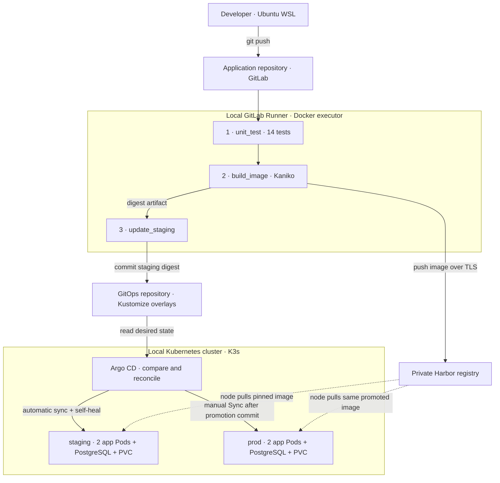
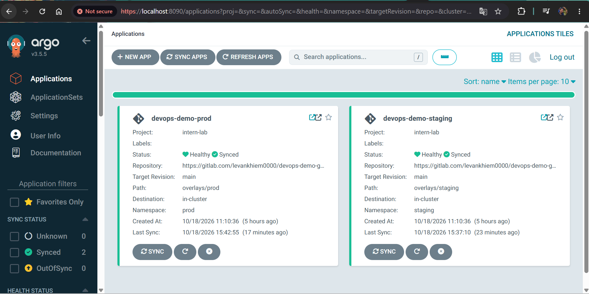

# Khiem DevOps Lab

### CI/CD & GitOps delivery for a Flask application

Build, publish and promote the **same container image** from staging to a production-like
environment using **GitLab CI → Kaniko → Harbor → Argo CD → Kubernetes**.

**Python / Flask · PostgreSQL · Docker · K3s / k3d · GitLab CI · Harbor · Kaniko · Argo CD · Kustomize**

[Architecture](#architecture) · [Pipeline](#pipeline) · [Evidence](#verified-results) ·
[Quickstart](#run-it-locally) · [Incident analysis](#incident-analysis-build-passed-runtime-failed) ·
[Learning guide](#six-phase-learning-map)

## Project highlights

| Delivery | Operations | Recovery |
|---|---|---|
| **14 automated tests** and three CI jobs | **Two environments**, separate databases and PVCs | **Real failed rollout** diagnosed and recovered |
| Kaniko build → private Harbor → GitOps commit | Automatic staging; reviewed, manual prod promotion | Git revert recovery and a non-root runtime regression check |

This personal project covers the complete path from a source change to a verified
release. A visible dashboard update was delivered automatically to staging, while
prod kept the previous version; the tested image was then promoted to prod.

**Environment:** local Docker Desktop/WSL with one K3s node. The namespace named
`prod` simulates a production release workflow. [Recorded evidence, 2026-10-18](docs/EVIDENCE.md).

## Architecture



**GitOps in this project:** the configuration repository declares which image and
Kubernetes resources each environment should run. Argo CD compares that desired
state with the cluster and reconciles it according to the environment policy.
CI updates Git; it does not receive Kubernetes deployment credentials.

<details>
<summary>Plain-text delivery flow</summary>

```text
Edit code --> Push application repo --> GitLab pipeline
                                           |
                  Test --> Kaniko build --> Push image to Harbor
                                           |
                                  Export image digest
                                           |
                                  Update staging overlay
                                           |
                                  Push GitOps commit
                                           |
                                  Argo CD auto-sync
                                           |
                                  Verify staging release
                                           |
                         Copy tested digest to prod + commit
                                           |
                              Review + manual Argo CD Sync
                                           |
                                  Verify prod release
```

</details>

### Repository responsibilities

| Repository | Responsibility |
|---|---|
| **[Application — public GitHub](https://github.com/khimkhum/devops-demo-app)** | Source, Dockerfile, tests, CI automation, bootstrap configuration and documentation |
| **[GitOps — public GitHub](https://github.com/khimkhum/devops-demo-gitops)** | Shared manifests, staging/prod overlays and Argo CD Applications |
| [Application — GitLab](https://gitlab.com/levankhiem0000/devops-demo-app) | Canonical source that triggers the delivery pipeline |
| [GitOps — GitLab](https://gitlab.com/levankhiem0000/devops-demo-gitops) | Canonical desired state watched by Argo CD |

GitHub repositories are public portfolio snapshots. The GitLab projects are private;
the screenshots and evidence document provide reviewable delivery results.

## Pipeline

Configured in [`.gitlab-ci.yml`](.gitlab-ci.yml). The Docker executor launches job
containers; Kaniko performs its image build without a Docker daemon API.

| Job | What it does | Output / control |
|---|---|---|
| **`unit_test`** | Runs 8 application cases and 6 GitOps automation cases | JUnit report; pip cache on the local Runner |
| **`build_image`** | Builds the multi-stage Dockerfile with the pinned Kaniko community image; pushes to Harbor | Commit-SHA and branch tags, OCI source/revision labels, digest and dotenv artifacts |
| **`update_staging`** | Uses the digest artifact to update the separate GitOps repository | Staging-only commit through temporary `CI_JOB_TOKEN`; no prod change |

Publishing and GitOps updates run on the application default branch. The update
job serializes staging writes, skips stale source pipelines, validates the digest,
rejects ambiguous entries and avoids a commit when nothing changed.
A normal Git push rejects conflicting history rather than force-overwriting it.

**Artifact promotion:** prod receives the exact digest validated in staging.
It is not rebuilt for production. `APP_VERSION` is configured display metadata;
the source commit, OCI labels and image digest identify the actual build.

[Job-token permissions and CI setup](docs/gitops-ci.md) ·
[Automation source](ci/update_gitops.sh) · [Digest update helper](ci/update_staging_image.py)

## Verified results

These are recorded lab observations, not live status badges or availability guarantees.

| Scenario | Observed result |
|---|---|
| CI execution | All three jobs passed; GitLab reported 14 tests |
| Automatic staging release | CI created a GitOps commit; Argo CD deployed its image |
| Production promotion | New dashboard appeared in prod after a promotion commit and manual Sync |
| Drift correction | A manual scale to 3 replicas was reconciled back to the configured 2 |
| Database outage in Compose | `/health` remained 200; `/ready` returned 503; readiness recovered after DB restart |
| Data persistence in Compose | A record survived container removal/recreation with the named volume retained |
| Failed rollout recovery | A GitOps revert restored a working image after a non-root import failure |
| Rollout drain exercise | 60 sampled readiness requests completed without failure after the timing changes |

<details>
<summary><strong>View screenshots — successful pipeline and Argo CD environments</strong></summary>

**GitLab pipeline:** three successful jobs, with 14 tests reported.


**Argo CD:** staging and prod both show Synced / Healthy in the supplied snapshot.



</details>

Exact source/GitOps commits, promoted digest and HTTP results:
**[Release evidence](docs/EVIDENCE.md)**.

## Run it locally

**Phase 2 / local application demo — Ubuntu WSL or another Linux shell.**
Requires Git, Docker Engine and Docker Compose. This path builds locally and does
not require the private Harbor registry, GitLab Runner or Kubernetes.

```bash
git clone https://github.com/khimkhum/devops-demo-app.git
cd devops-demo-app
cp .env.example .env
vim .env
```

Replace the sample database password, then start the application:

```bash
docker compose up -d --build
bash scripts/check-health.sh http://127.0.0.1:8084
curl -fsS --max-time 10 http://127.0.0.1:8084/ready
```

Open **[http://localhost:8084](http://localhost:8084)**.
Expected readiness response after startup:

```json
{"database":"connected","status":"ready"}
```

If the first request reaches the application before it finishes starting, check
`docker compose ps` and `docker compose logs --tail 30 app`, then retry.

Stop with `docker compose down`; the named database volume remains.
Adding `-v` deletes that volume and its database data.

### Application endpoints

| Endpoint | Purpose |
|---|---|
| `/` | Dashboard showing configured environment/version and a real health-check button |
| `/health` | Application HTTP health, independent of PostgreSQL |
| `/ready` | Database connection and `SELECT 1`; 503 when not ready |
| `/version` | Runtime `APP_ENV` and `APP_VERSION` |

### Run the automated tests

**Phase 4 / tests — Linux shell with Git and Python 3.14 installed:**

```bash
python3 -m venv .venv
source .venv/bin/activate
python -m pip install -r requirements-dev.txt
python -m pytest -q --junitxml=reports/junit.xml
```

Application tests mock database interactions. GitOps tests use disposable local
Git repositories to verify validation, staging/prod separation, idempotency,
commit/push behavior and stale-pipeline rejection. Live DB and routing checks
are documented separately in the release evidence.

## Kubernetes and release controls

| Concern | Implementation and reason |
|---|---|
| Runtime permissions | UID/GID 10001; no privilege escalation; Linux capabilities dropped; automatic service-account token mount disabled for the app |
| Startup and health | Startup probe allows initialization; readiness gates traffic; liveness checks app health without making DB availability a restart condition |
| Rolling update | Two replicas, `maxUnavailable: 0`, `maxSurge: 1`, `minReadySeconds: 5`, preStop delay and a termination grace period |
| Resource planning | CPU/memory requests and limits plus a ResourceQuota in each namespace |
| Configuration | ConfigMaps for ordinary settings; external Secrets for DB and registry credentials |
| Persistence | PostgreSQL StatefulSet with a separate 1Gi local-path PVC per environment |
| Image identity | Digest-pinned releases; promote the same artifact between environments |
| Registry authentication | Private CA and distinct push/pull robot permissions |

| Environment | Route | Sync policy |
|---|---|---|
| **Staging** | `http://localhost:8088` | Automatic sync and self-heal; auto-prune disabled |
| **Prod lab** | Host `prod.devops.test`, port `8088` | Reviewed promotion commit, then manual Argo CD Sync |

**Phase 6 / verify an existing prod deployment — Ubuntu WSL:**

```bash
curl -fsS --max-time 10 \
  --resolve prod.devops.test:8088:127.0.0.1 \
  http://prod.devops.test:8088/ready

curl -fsS --max-time 10 \
  --resolve prod.devops.test:8088:127.0.0.1 \
  http://prod.devops.test:8088/version
```

Verify `environment: prod`, the target Git revision and the Deployment image digest.
HTTP 200 alone can be misleading if a missing prod Ingress lets the request reach
the hostless staging route. Similarly, Healthy can describe an older release.

**Promotion:** review the staging digest → update the prod overlay → commit/push →
review Argo CD Diff → manual Sync → verify revision, digest and readiness.

**Rollback:** revert the reviewed bad release commit in GitOps and push. Staging
reconciles automatically; prod requires manual Sync. An image rollback does not
roll back database schema or data.

[Cluster setup](docs/SETUP.md) · [Operational commands and rollback](docs/RUNBOOK.md) ·
[Interview demo](docs/DEMO.md)

## Incident analysis: build passed, runtime failed

| Step | Finding / action |
|---|---|
| **Symptom** | CI built an image successfully, but the new Pod entered CrashLoopBackOff and Argo CD eventually reported Degraded |
| **Diagnosis** | A root-owned Gunicorn package directory had mode 700; runtime UID 10001 could not import `gunicorn.app` |
| **Recovery** | Reverted the GitOps image update; Argo CD reconciled back to the working image |
| **Fix** | Kept credentials under `umask 077`, restored `umask 022` for build files and added an import check after `USER appuser` in the Dockerfile |
| **Verification** | Built with Kaniko, started Gunicorn as UID 10001, checked HTTP health and completed staging/prod delivery |

**Lesson:** a successful image build does not prove that the configured runtime
user can start the application. The failure led to an explicit build-time check
under the same non-root user used at runtime.

[Detailed troubleshooting and incident notes](docs/RUNBOOK.md#6-khi-rollout-lỗi)

## Six-phase learning map

| Phase | Knowledge applied | Implementation / evidence |
|---|---|---|
| **1 · Linux & Git** | Files, permissions, processes, environment variables, TCP/DNS/HTTP, logs, exit codes, version control | Health script, permissions/network exercises and Git history |
| **2 · Containers & registry** | Image/container lifecycle, multi-stage builds, daemon vs Kaniko, Compose, volumes, TLS and robot permissions | Dockerfiles, Compose, Harbor push/pull and persistence checks |
| **3 · Kubernetes** | Deployment/ReplicaSet/Pod, Services/Ingress, ConfigMap/Secret, StatefulSet/PVC, quota and probes | Handwritten manifests and running namespace workloads |
| **4 · CI** | Runner/executor, jobs/stages/rules, variables, cache, artifacts and test reports | Three-job pipeline and 14 automated tests |
| **5 · GitOps** | Desired state, separate repositories, Kustomize, reconciliation, self-heal and sync/health status | Argo CD Applications and staging drift correction |
| **6 · Delivery & recovery** | Staging validation, artifact promotion, manual release control, Git revert and incident analysis | Visible code change through prod, rollback exercise and runbook |

The **[Vietnamese six-phase study guide](docs/ROADMAP.md)** explains the commands,
concepts, checks and scope of each phase. NodePort, cloud LoadBalancer and etcd
are covered as concepts; this lab does not claim to deploy every topology.

<details>
<summary>Repository map and documentation</summary>

```text
devops-demo-app/
|-- app.py                     # Flask application
|-- templates/ and static/     # Dashboard
|-- Dockerfile                 # Current multi-stage non-root runtime
|-- Dockerfile.single-stage    # Earlier build comparison
|-- compose.yaml               # Local app + PostgreSQL
|-- compose.harbor.yaml        # Earlier registry deployment exercise
|-- .gitlab-ci.yml             # Test -> build -> GitOps
|-- ci/                        # Staging update automation
|-- tests/                     # Application and GitOps automation tests
|-- scripts/                   # HTTP health-check script
|-- infra/                     # k3d, Argo CD and Runner bootstrap
|-- k8s/staging/               # Phase 3 manual-manifest exercise
`-- docs/                      # Setup, operations, evidence and study notes
```

The **separate GitOps repository** contains the current `base/`, environment
overlays and Applications. Its manifests are the source used by Argo CD.

| Document | Read it for |
|---|---|
| [SETUP](docs/SETUP.md) | Tool versions, external Harbor/CA prerequisites, Runner, Secrets and cluster bootstrap |
| [RUNBOOK](docs/RUNBOOK.md) | Start/check the lab, promote, rollback and troubleshoot |
| [DEMO](docs/DEMO.md) | A guided source-to-prod interview demo |
| [EVIDENCE](docs/EVIDENCE.md) | Recorded commits, image digest, HTTP checks and observations |
| [ROADMAP](docs/ROADMAP.md) | Vietnamese knowledge review for all six phases |
| [CV](docs/CV.md) | CV wording, project introduction and interview questions |

</details>

## Scope and next improvements

This is a reproducible application demo plus a locally operated CI/CD lab.
Full delivery requires the private LAN Harbor, CA trust, Runner and cluster
described in SETUP. Real `.env` files, private keys, tokens and kubeconfig stay outside Git.

- **Availability:** one K3s node with its default SQLite datastore; two app replicas support rollout but do not provide node-level HA.
- **Data:** local-path persistence is not backup; database migration and backup/restore drills are future work.
- **Isolation:** namespaces provide logical separation; NetworkPolicy and least-privilege DB roles are future improvements. The lab uses the PostgreSQL bootstrap role.
- **Operations:** centralized monitoring, public-cloud deployment and multi-person release approval are outside the demonstrated scope.

## Credits

Dashboard adapted from **[Tooplate Neon Carbon](https://www.tooplate.com/view/2165-neon-carbon)**;
original attribution is retained. [Tooplate terms](https://www.tooplate.com/about).
Backend endpoints, containerization, CI/GitOps automation and deployment exercises
are implemented in this project.
