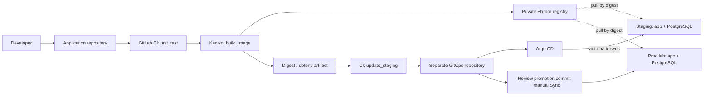

# Khiem DevOps Lab — GitLab CI and Argo CD GitOps

An end-to-end delivery lab for a Flask/Gunicorn application with PostgreSQL.
Code is tested, packaged with Kaniko, published to Harbor, and deployed through a
separate GitOps repository. Staging updates automatically; production promotion
requires an explicit configuration change and manual Argo CD Sync.

**Verified:** 14 automated tests, three successful CI jobs, automatic staging
deployment, manual production promotion, drift correction, and Git-based recovery
from a failed image rollout. Both environments run on a local single-node
Kubernetes cluster.


## Delivery architecture



CI writes a normal Git commit using a temporary GitLab job token. It has no
Kubernetes deployment credentials. Argo CD applies the desired Kubernetes state.

## Repositories and source of truth

| Repository | Purpose |
|---|---|
| [Application — GitLab](https://gitlab.com/levankhiem0000/devops-demo-app) | Canonical CI source: application, tests, build and CI configuration |
| [GitOps — GitLab](https://gitlab.com/levankhiem0000/devops-demo-gitops) | Canonical desired state watched by Argo CD |
| [Application — GitHub](https://github.com/khimkhum/devops-demo-app) | Public portfolio snapshot |

The GitLab projects are private. The screenshot and [release evidence](docs/EVIDENCE.md)
let reviewers inspect verified results without access to the private CI instance.
GitHub publication is a separate snapshot step; GitLab remains the delivery source.

## Try the application locally

**Run in Ubuntu/WSL or another Linux shell.** Requires Git, Docker and Docker Compose.
This Compose path builds locally and does not need the private Harbor instance.

```bash
git clone https://github.com/khimkhum/devops-demo-app.git
cd devops-demo-app
cp .env.example .env
vim .env
```

Replace the sample database password, then run:

```bash
docker compose up -d --build
bash scripts/check-health.sh http://127.0.0.1:8084
curl -fsS --max-time 10 http://127.0.0.1:8084/ready
```

Open [the local application](http://localhost:8084). Stop with
`docker compose down`; the named database volume is retained.
`docker compose down -v` also deletes that database volume.

| Endpoint | Meaning |
|---|---|
| `/` | Dashboard with configured environment/version and a real health-check button |
| `/health` | Application HTTP health, independent of PostgreSQL |
| `/ready` | PostgreSQL connection and `SELECT 1`; returns 503 when unavailable |
| `/version` | Values from `APP_ENV` and `APP_VERSION` |

`APP_VERSION` is configuration metadata. Exact source/build provenance comes
from the CI commit, image labels, GitOps commit and pinned image digest.

## Kubernetes deployment

Each namespace has two application replicas, a PostgreSQL StatefulSet, a separate
1Gi local-path PVC, ConfigMap, database Secret, image-pull Secret and ResourceQuota.

| Environment | Routing | Release policy |
|---|---|---|
| Staging | `http://localhost:8088` | Argo CD auto-sync and self-heal; auto-prune disabled |
| Prod lab | Host `prod.devops.test`, port `8088` | Promotion commit followed by manual Sync |

Application containers run as UID/GID 10001. Startup/readiness/liveness probes,
resource requests/limits, `maxUnavailable: 0`, `maxSurge: 1`, a 5-second
`minReadySeconds` before availability, and a 5-second preStop delay support rollout.

Check production routing without buying a domain:

```bash
curl -fsS --max-time 10 \
  --resolve prod.devops.test:8088:127.0.0.1 \
  http://prod.devops.test:8088/ready
```

Fresh cluster setup and external prerequisites are documented in
[SETUP](docs/SETUP.md). Existing-lab operations are in the [runbook](docs/RUNBOOK.md).

## Pipeline

| Stage/job | Work and output |
|---|---|
| `test / unit_test` | Install dependencies, run 14 pytest tests; upload JUnit; use local Runner pip cache |
| `build / build_image` | Multi-stage Dockerfile through Kaniko; push commit-SHA and branch tags to Harbor; publish digest and dotenv artifacts |
| `gitops / update_staging` | Consume the digest artifact; change only the staging overlay; commit and push through `CI_JOB_TOKEN` |

The GitOps update job runs only on the application default branch. It serializes
updates, skips stale source pipelines, rejects invalid/ambiguous digests and avoids
extra commits when the digest is unchanged. A normal push rejects conflicting
remote history. Production stays unchanged until separately promoted.

[GitOps CI configuration and permissions](docs/gitops-ci.md)

## Tests

**Run in a Linux shell with Git and Python 3.14 installed:**

```bash
python3 -m venv .venv
source .venv/bin/activate
python -m pip install -r requirements-dev.txt
python -m pytest -q --junitxml=reports/junit.xml
```

The suite covers application endpoints, mocked database success/failure, invalid
deployment inputs, staging/prod separation, and real commit/push operations against
disposable local Git repositories. Live PostgreSQL and Ingress checks are recorded
separately in the evidence document.

## Repository map

| Path | Role |
|---|---|
| `app.py`, `templates/`, `static/` | Flask application and dashboard |
| `Dockerfile` | Current multi-stage, non-root runtime used by CI |
| `Dockerfile.single-stage` | Earlier learning comparison |
| `compose.yaml` | Local app + PostgreSQL |
| `compose.harbor.yaml` | Earlier digest-pinned registry deployment exercise |
| `ci/`, `.gitlab-ci.yml` | Build-to-GitOps automation |
| `infra/k3d/`, `infra/argocd/`, `infra/gitlab-runner/` | Lab bootstrap configuration |
| `k8s/staging/` | Phase 3 manual-manifest exercise |
| Separate GitOps repo | Current `base/`, environment overlays and Argo CD Applications |
| `docs/` | Setup, operations, evidence, demo, roadmap review and CV notes |

## What was learned from a real failure

A successful CI build initially produced an image whose Gunicorn package directory
was owned by root with mode 700. UID 10001 could not import `gunicorn.app`, so
the new Pod entered CrashLoopBackOff. Existing healthy replicas continued serving.

The fix kept registry credentials private while restoring normal build permissions,
added a dependency import check as the runtime user, and was validated with Kaniko
and an actual Gunicorn HTTP request. The failed rollout was recovered through a
Git revert and Argo CD reconciliation. See [the runbook](docs/RUNBOOK.md).

## Scope and limits

This is an internship project on Docker Desktop/WSL and one k3d/K3s node.
The default K3s datastore in this configuration is SQLite, not an HA etcd cluster.
Two app replicas on one node do not provide node-level high availability.

Harbor uses a private LAN address and private CA; full CI needs that registry to
be reachable from the Runner and Kubernetes node. Certificates, private keys,
tokens, kubeconfig and real environment files are provisioned outside Git.
Namespaces provide logical separation; NetworkPolicy and least-privilege database
roles are not implemented. PostgreSQL uses its bootstrap role in this lab.
Local-path persistence is not a database backup or disaster-recovery solution.
No database migration, centralized monitoring stack or public-cloud deployment is claimed.

## Demo and learning notes

- [Live demo and promotion checklist](docs/DEMO.md)
- [Six-phase roadmap review](docs/ROADMAP.md)
- [CV bullets and interview preparation](docs/CV.md)
- [Verified release evidence](docs/EVIDENCE.md)

## Credits

Dashboard adapted from [Tooplate Neon Carbon](https://www.tooplate.com/view/2165-neon-carbon).
Original template attribution is retained; see [Tooplate terms](https://www.tooplate.com/about).
