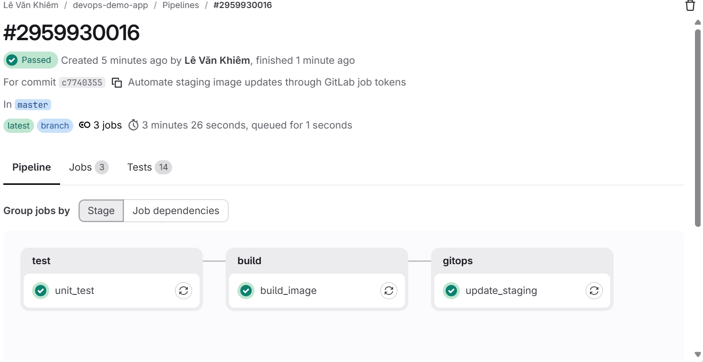

# Verified delivery evidence

Snapshot date: **2026-10-18**. This is a record of observed lab results, not a live
status page. Future documentation commits may trigger new staging builds.

## CI evidence

The supplied screenshot shows GitLab pipeline
[2959930016](https://gitlab.com/levankhiem0000/devops-demo-app/-/pipelines/2959930016)
for source commit `c7740355`: all three jobs succeeded and the Tests tab shows 14 tests.



This pipeline produced GitOps commit `2fab7e1` automatically. Argo CD was observed
detecting it and rolling out staging without a manual Refresh or Sync.

## Visible application release

| Item | Observed value |
|---|---|
| Application source commit | `754e72a` — update dashboard and standardize line endings |
| Automatic staging GitOps commit | `b710df3` — update staging image for `754e72ae` |
| Approved production promotion commit | `6d60dba` |
| Promoted digest | `sha256:90e69d331b94dcf8874982c02d6fb59098519d75f70f04698a8939bc66459858` |

Before promotion, staging returned the new text `CI/CD LAB` while prod still
returned `APPLICATION DEMO`. After manual prod Sync, prod returned `CI/CD LAB`.

Final observed application state:

```text
NAME                  SYNC STATUS   HEALTH STATUS
devops-demo-prod       Synced        Healthy
devops-demo-staging    Synced        Healthy
```

Production `/ready` returned HTTP 200 with:

```json
{"database":"connected","status":"ready"}
```

Production `/version` returned `environment: prod`, confirming that Host-based
Ingress routing reached prod rather than the hostless staging route.

## Other verified exercises

- Compose database data survived container recreation with the named volume retained.
- Stopping the Compose database left `/health` at 200 and made `/ready` return 503.
- Restarting that database restored readiness without restarting the app.
- A direct staging scale from two to three replicas was reconciled back to two by Argo CD.
- A bad CI image failed to import Gunicorn as UID 10001; its Pod entered CrashLoopBackOff.
- GitOps revert `f7ae4fb` restored the previous working image.
- Corrected source commit `0b84bf4` added explicit build permissions and a non-root import check.
- Corrected image was tested as UID 10001 and through a real Gunicorn `/health` request.
- During the rollout-drain exercise, 60 sampled readiness requests had zero failures
  after adding the readiness/termination delays. This is a bounded lab observation,
  not a universal zero-downtime guarantee.

## Claims deliberately excluded

No production business traffic, multi-node failover, etcd HA, automated PostgreSQL
backup/restore, distributed cache, cloud infrastructure or monitoring stack was
demonstrated. Data persistence and a tested database backup are different claims.
